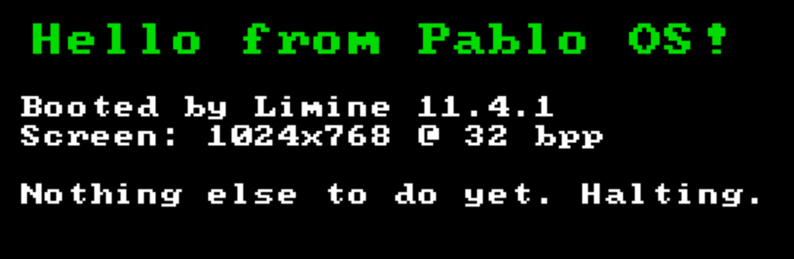

# Pablo OS

A hobby x86-64 operating system written in C, built to learn how computers work from the metal up.



## Status

**Step 1 is done:** the kernel boots through the [Limine](https://github.com/limine-bootloader/limine) bootloader, and it prints to the screen and the serial port. It runs in QEMU with BIOS or UEFI firmware, and the same image can boot a real PC from a USB stick.

## Roadmap

1. ✅ Toolchain and boot: a hello-world kernel and a bootable ISO
2. ⬜ Core kernel: GDT/IDT, exception handlers, a timer interrupt, keyboard input
3. ⬜ Memory management: a physical page allocator, paging, a kernel heap
4. ⬜ Show-off milestone: a tiny shell (`help`, `mem`, `uptime`, `reboot`) with basic multitasking

## Setup (Ubuntu)

```sh
sudo apt install build-essential git xorriso qemu-system-x86 ovmf gdb
```

On x86-64 Linux, the system `gcc` and `ld` work for building the kernel. The flags in `GNUmakefile` turn off everything that assumes an OS underneath, such as the C library, SSE and the red zone.

## Build and run

```sh
make            # builds pablo-os.iso (fetches Limine on the first run)
make run        # boots it in QEMU; serial output appears in your terminal
make run-uefi   # the same, with UEFI firmware instead of legacy BIOS
make debug      # starts paused; then in another terminal:
                #   gdb build/kernel -ex "target remote :1234"
make clean
```

## Booting real hardware from a USB stick

> ⚠️ This erases the USB stick. Double-check the device name with `lsblk` first, because writing to the wrong one wipes that disk.

```sh
make
sudo unmount /dev/sdX
sudo dd if=pablo-os.iso of=/dev/sdX bs=4M status=progress oflag=sync
sync
```

Then reboot, open your firmware's boot menu (usually F12, F11, F8 or Esc), and pick the USB stick. You may need to disable Secure Boot first. On Windows, [Rufus](https://rufus.ie) can write the ISO in "DD image" mode.

For a step-by-step walkthrough of building, running and writing the USB stick, see [docs/BUILD-AND-RUN.md](docs/BUILD-AND-RUN.md).

## Layout

```
GNUmakefile      build, ISO packaging, QEMU targets
linker.ld        places the kernel at 0xffffffff80000000 (the higher half)
limine.conf      boot menu entry
include/limine.h Limine boot protocol header (vendored)
src/kernel.c     kmain: the entry point, plus the Limine requests
src/fb.c         text drawing on the framebuffer
src/font8x8.h    8x8 bitmap font (public domain)
src/serial.c     COM1 serial output for debugging
src/io.h         port I/O (inb/outb) and halt
src/string.c     memcpy/memset/memmove/memcmp (required by GCC)
```

## How it boots

1. The firmware (BIOS or UEFI) loads Limine from the ISO.
2. Limine reads `limine.conf`, loads `boot/kernel` (an ELF file), and switches the CPU into 64-bit long mode with paging enabled.
3. Limine scans the kernel for *requests*, which are the `volatile` structs in `kernel.c`, and fills in the answers. For example, the framebuffer request returns the screen's address and size.
4. Limine jumps to `kmain`. From there on, everything is our code.
